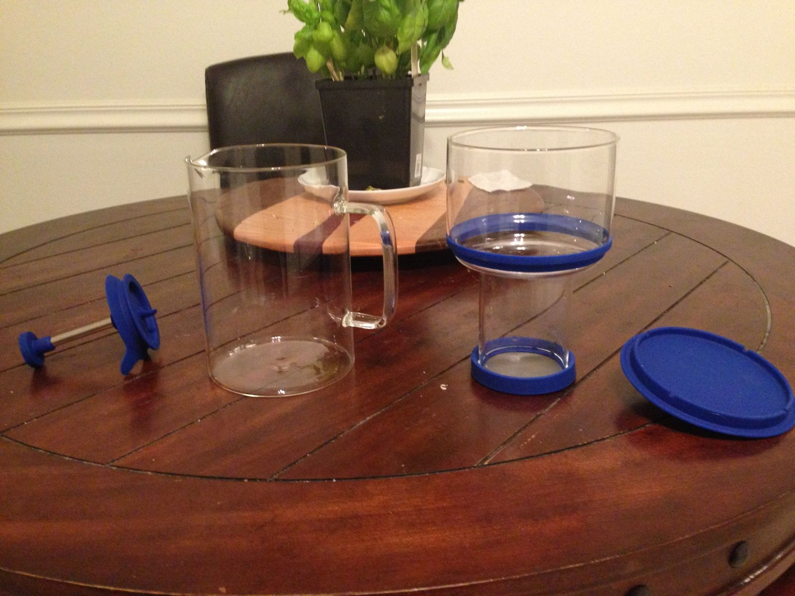
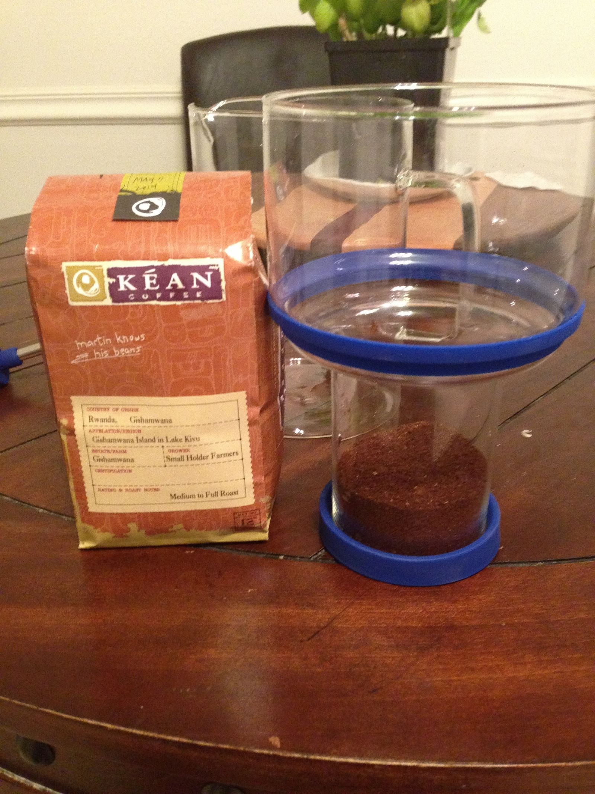
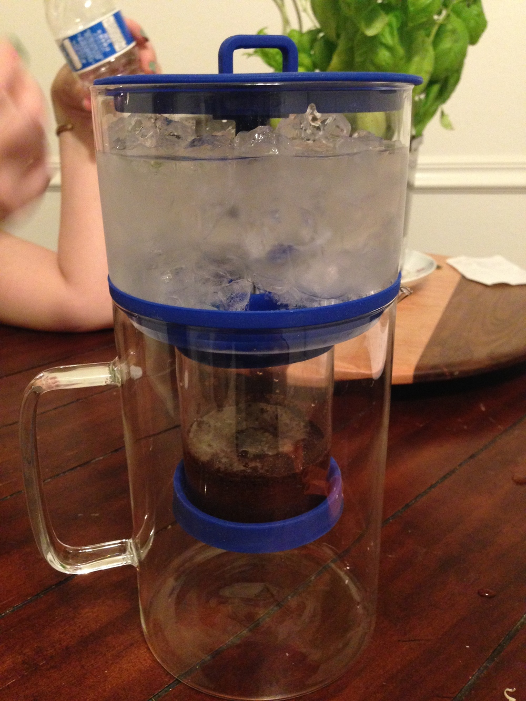
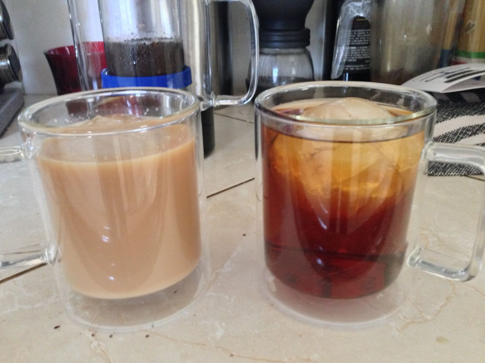

So I recently got my hands on a Cold Bruer from [bruer.co](http://www.bruer.co), and I'm kinda smitten. Coffee is a huge staple of my morning, so I've gotten into the habit of getting decent coffee beans and usually grinding them myself (but would love to get a decent espresso grinder). That being said, I'm also a gadget whore and like getting my hands on new equipment to try, so when my wife immediately jumped on getting it, how could I say no?

It essentially makes coffee via a cold brewed method by slowly dripping cold water over coffee grounds. It makes a coffee concentrate that keeps all of the flavor, but none of the acids, so it's not as heavy on the stomach or the teeth.

---

After having put it through its paces a few times, I can say that I really like it. It's great to have iced coffee in the morning, and it's remarkably simple to get going.

---

To test, I ended up using Kean coffee, a small artisan roasting company in Orange County that sources their beans from small growers in various countries.

Grind the beans to something slightly smaller than drip grind, but not espresso grind, then take the grounds and pour them into the 'not quite so funnel'. From there, add a paper filter on top of the coffee (these are the same filters you get for an Aeropress), wet the grounds with about 1 oz of cold water, then put the water spigot on.

The spigot can turn and adjust the drip rate of the water to what you want. The guys who made the Bruer recommend about one drop per second, and because I don't know any better, I did exactly that.

---

Once the stopper is in place, you put 12oz of cold, fresh water, and 12oz of ice on top of the stopper. From there, you adjust the drip rate via the knob on the stopper and then wait 8-12 hours for the process to complete.

The first time I used the Bruer, I noticed that the water seemed to be used up quicker than what was stated, so I think adjusting it to drip slower than one drop per second probably is a better idea. Adding more coffee grounds to the Bruer probably would slow the rate as well.

Either way, once the Bruer is done, we got a great tasting cold brewed coffee concentrate that works really well in a small amount by itself, mixed with water, or milk/cream. My wife and I ended up spending a bit extra and getting the double-walled mugs as well, for more than just that they look nice and are double-walled.

The only real concern I have with the Cold Bruer is the glass it is made with. It is *really* thin. I feel I'll break it by just holding it too tight. Luckily, the packaging it came in is great for storage, so I don't think I'll be throwing away the packaging anytime soon.
